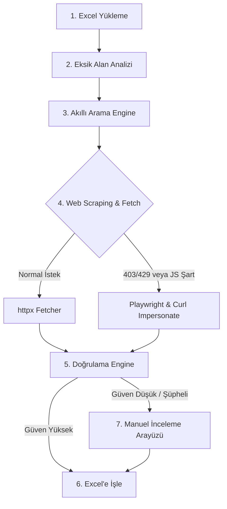

# Üniversite Veri Otomasyonu Botu - Sistem ve Çalışma Açıklaması

Bu doküman, **Üniversite Veri Otomasyonu** sisteminin ne işe yaradığını, mimarisini, adım adım çalışma mantığını ve kullandığı teknolojileri detaylandırmaktadır.

---

## 📌 1. Ne İşe Yarıyor? (Proje Amacı)

Bu sistem, üniversite verilerini içeren Excel listelerindeki eksik bilgileri (örneğin *Program Listesi*, *Kabul Şartları*, *Dil Şartları*, *Ücretler*) otomatik olarak web üzerinde araştıran, doğrulayan ve elde ettiği resmî bağlantıları Excel dosyasının formatını bozmadan tamamlayan akıllı bir otomasyon botudur.

### Çözdüğü Problem:
* **Zaman Kaybı:** Yüzlerce üniversitenin resmî sitelerini tek tek gezme ve arama motorlarında arama yapma ihtiyacını ortadan kaldırır.
* **Manuel Hata Riskleri:** Yanlış veya güncel olmayan URL'lerin Excel'e girilmesini önler.
* **Format Bozulmaları:** Excel dosyalarının hücresel stil, renk ve düzen yapılarını korur.

---

## ⚙️ 2. Adım Adım Çalışma Mantığı (Akış)

### 1. Excel Girdisi ve Analiz ([excel_reader.py](file:///c:/Users/lenovo/OneDrive/Desktop/uni-veri-otomasyonu/src/excel_reader.py))
* Yüklenen Excel dosyası okunur.
* Her satırdaki üniversite adı, resmî domaini ve eksik bilgi bayrakları (`Evet/Hayır`) tespit edilir.

### 2. Akıllı Arama & URL Keşfi ([search/](file:///c:/Users/lenovo/OneDrive/Desktop/uni-veri-otomasyonu/src/search/))
* **Sitemap & Resmî Site Taraması:** Önce üniversitenin kendi sitemap haritası ve ana menü bağlantıları taranır.
* **Arama Motoru Fallback:** Arama sorguları üretilerek **DuckDuckGo, Bing ve Google** üzerinden hedeflenmiş aramalar yapılır.

### 3. Sayfa Çekme ve Metin Çıkarma ([fetch/](file:///c:/Users/lenovo/OneDrive/Desktop/uni-veri-otomasyonu/src/fetch/))
* Bulunan web sayfaları ve PDF dokümanları indirilir.
* Güvenlik engellerine (403/429) veya JavaScript zorunluluğu olan sitelere karşı **Playwright** (gerçek Edge/Chromium) ve `curl` taklitçisi devreye girer.

### 4. Doğrulama & Puanlama ([validation/](file:///c:/Users/lenovo/OneDrive/Desktop/uni-veri-otomasyonu/src/validation/))
* **Kural Motoru (Rule Engine):** Anahtar kelimeler, URL kalıpları ve içerik analiziyle sayfaya bir **Güven Puanı (Confidence Score)** atanır (Tamamen ücretsizdir).
* **Program Kalite Kapısı:** Derece/sertifika adı, URL yapısı ve sayfadaki program bağlamını birlikte doğrular; blog, kayıt, liste ve genel politika sayfalarını program satırı olarak reddeder.
* **Kanıt Doğrulama:** Yazılacak her değerin kanıt kesitini aynı resmî kaynakta doğrular.
* **Katalog Bağlamı:** Resmî akademik katalog PDF'sinde yalnızca ilgili program adının çevresindeki bölümü kullanır.

### 5. Çıktı Üretimi ve Manuel İnceleme ([excel_writer.py](file:///c:/Users/lenovo/OneDrive/Desktop/uni-veri-otomasyonu/src/excel_writer.py) & [manual_review.py](file:///c:/Users/lenovo/OneDrive/Desktop/uni-veri-otomasyonu/src/manual_review.py))
* Yüksek güvenilirlikteki bağlantılar doğrudan Excel'e kaydedilir.
* Şüpheli veriler Streamlit arayüzündeki **Manuel İnceleme Ekranı**na yönlendirilir.

---

## 🛠️ 3. Kullanılan Teknolojiler ve Kütüphaneler

| Kategori | Kütüphane / Araç | Kullanım Amacı |
| :--- | :--- | :--- |
| **Arayüz (UI)** | `streamlit` | Web arayüzü, dosya yükleme ve onay paneli ([app.py](file:///c:/Users/lenovo/OneDrive/Desktop/uni-veri-otomasyonu/app.py)) |
| **Excel Veri Yönetimi** | `openpyxl` | Hücre stilleri ve biçimlendirmeleri koruyarak Excel okuma/yazma |
| **Veri Şablonları & Tip Güvenliği** | `pydantic`, `pydantic-settings` | Veri yapıları, doğrulama ve konfigürasyon yönetimi |
| **Ağ ve HTTP İstemcisi** | `httpx` | Asenkron, hızlı web istekleri |
| **Scraping & Tarayıcı Otomasyonu** | `playwright` | Bot korumalı veya JS yüklü siteleri açmak için headless tarayıcı |
| **Metin & Doküman Analizi** | `beautifulsoup4`, `lxml`, `pypdf` | HTML ve PDF içeriklerinden temiz metin çıkarma |
| **Hata & Retry Yönetimi** | `tenacity` | Başarısız isteklerde otomatik yeniden deneme mekanizması |

---

## ✨ 4. Öne Çıkan Özellikler

1. **API Anahtarsız Çalışma:** Sistem kural ve kanıt tabanlıdır; harici AI API anahtarı kullanmaz.
2. **Format Garantisi:** Girdi Excel dosyasının renk, font ve stil ayarlarına zarar vermez.
3. **Akıllı Güvenlik Bypass:** Tarayıcı taklitçisi ve Playwright entegrasyonu sayesinde 403/429 erişim engellerini aşar.
4. **İnsan Onayı (Human-in-the-loop):** Şüpheli sonuçları kullanıcıya sunarak hata yapma riskini sıfıra indirir.
