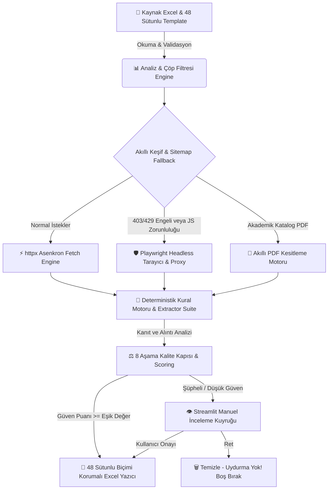

# 🎓 Üniversite Veri Otomasyonu & 48 Sütunlu Program Pipeline (v3.1)

> **Yüksek Hassasiyetli, API Anahtarsız, %100 Deterministik & Kanıt (Evidence) Tabanlı Üniversite Veri Toplama, Doğrulama ve Excel Otomasyon Sistemi.**

[](https://www.python.org/downloads/)
[](https://streamlit.io)
[](https://docs.pytest.org)
[](#)

---

## 🌟 Sistem Hakkında & Vizyon

**Üniversite Veri Otomasyonu**, yüklenen kaynak Excel dosyalarındaki üniversitelerin resmî web sitelerini, sitemap haritalarını ve akademik katalog PDF'lerini derinlemesine tarayarak, eksik kabul kuralları, program detayları, yabancı dil yeterlilikleri, eğitim ücretleri ve sürelerini otomatik olarak tespit eder.

Sistem **%100 deterministik kural ve RegEx motorlarıyla**, açık **kanıt (quote) cümlesi barındıran** verileri derler. Toplanan tüm bilgiler 8 aşamalı sert kalite kapısından (Hard QA Gate) geçtikten sonra, orijinal Excel dosyasının hücresel stiline ve renklerine zerre kadar zarar vermeden **48 sütunlu** hassas çıktı biçiminde üretime aktarılır.

---

## 🔥 Ana Özellikler & Öne Çıkan Mühendislik Yenilikleri

### 1. 🛡️ 8 Aşama Sert Kalite Kuralı Motoru & Otomatik QA
Üretilen ve çıkarılan her satır Excel hücresine basılmadan önce **8 amansız denetim kuralından** geçer:
1. **Yüksek Doluluk (Completeness Check):** Eğitim süresi, kabul GPA, yıllık ücret gibi kritik sütunların eksiksiz dolulup dolmadığı matematiksel olarak ölçülür.
2. **Yalnızca Gerçek + Doğrulanmış Programlar:** Akıllı taksonomi ve içerik süzgeci sayesinde genel program listeleri, blog haberleri, kayıt portalı sayfaları, duyurular ve JSON-LD şemaları program sayılmaz; sert bir şekilde reddedilir.
3. **Resmî Kaynak Güvencesi (Domain Trust):** Yalnızca üniversiteye ait tescilli kurumsal domain ağacı taranır, üçüncü parti güvensiz platformlar sisteme dahil edilmez.
4. **Kapsama Uygun Politika Birleştirme (Scope Priority):** Lisans ile Yüksek Lisans sayfaları ayrıştırılır; genel üniversite politikaları program özel verilerle hiyerarşik olarak harmanlanır.
5. **Kanıt Kesitleri (Evidence Annotation):** Çıkarılan her alan için dayanak oluşturan kaynak alıntı cümlesi ve kaynak URL, doğrudan ilgili Excel hücresinin açıklamasına/yorumuna nakledilir.
6. **Tekilleştirme & Çöp Filtresi:** Boşluk, noktalama ve büyük-küçük harf duyarsız anahtarlama sayesinde aynı programın farklı başlık varyasyonları çift kayıt yapmaz, çöp veriler temizlenir.
7. **Uydurma Sıfır — "Kanıt Yoksa Boş Bırak":** Destekleyici açık web kanıtı bulunmayan hücrelere asla sabit, rastgele veya tahminî bir veri yazılmaz; hücre tertemiz boş bırakılır.
8. **Görsel QA Özet Paneli:** İşlem bitiminde Streamlit ekranı üzerinde doluluk barları, renk kodlu kartlaşmış kural raporları ve canlı başarı grafiği açılır.

### 2. 🧮 Genişletilmiş ve Deterministik Veri Çıkarıcı Suite
Sistem, dil bilimsel bağlam analizi yapan uzmanlaştırılmış harbi çıkarıcı modülleri kucaklar:
- ⏳ **Eğitim Süresi (3 Tier Extractor):** Derece ve yıl birlikteliği (0.93 güven), sayfa içi anısal bağlam (0.88 güven) ve toplam kredi saatinden matematiksel tahmin (0.78 güven) katmanları.
- 🎓 **Minimum Kabul GPA (Row-based Isolation):** Sürdürme ve mezuniyet GPA eşiklerini atlayan, sadece kabul şartına yönelen satır bazlı izolasyon algoritmaları.
- 🗣️ **Dil Yeterlilik (IELTS, TOEFL, Duolingo):** Program özel minimum test eşiklerini ve koşul kural setlerini kusursuz çeken motor.
- 💰 **Harç ve Başvuru Ücretleri:** Yıllık eğitim ücretleri ile tek seferlik başvuru maliyetlerini ayıklayan semantik okuyucular (`tuition.py`, `application_fee.py`).
- 💼 **Kariyer Çıktıları & Başvuru Belgeleri:** Standard test zorunluluğu (SAT/GRE), staj (internship) imkanları ve aranan resmi belge takımı çıkarıcıları.

### 3. 🕷️ Çok Katmanlı Güvenli Tarama & Çöl Geçirmez Tarayıcı Mimarisi
- **Hızlı Katman (httpx Asenkron):** Saniyelik asenkron eşzamanlı HTTP istekleriyle sitemizi bloklama yapmayan siteler anında parse edilir.
- **Direnme Katmanı (Playwright & Impersonation):** Cloudflare, 403 Forbidden, 429 Too Many Requests engeline takılan ya da mecburi JavaScript talep eden hedeflerde akıllıca **Headless Chromium / Edge Tarayıcı (Playwright)** ile Proxy desteği tetiklenir.
- **PDF Katalog Cımbızlama:** Resmî akademik katalog PDF'leri okunduğunda dosyanın tümü değil, yalnızca aranan spesifik program başlığının çevresindeki **bağlam sekmeleri** (content sections) izole edilir.
- **Akıllı URL Esnekliği ("Gerekli Değil" Fallback):** Kaynak Excel tablolarında `Gerekli değil`, `N/A`, `Mevcut` ibareleri geçiyorsa üniversite es geçilmez; kurumsal kök domain üzerinden yeni tarama patikası kesintisiz açılır.

### 4. 💾 Checkpoint & Kesinti Koruması
Tarama uzun mu sürüyor? Elektrik veya bağlantı mı kesindi? Akıllı checkpoint mekanizması (`checkpoint.py`), tamamlanan her safhayı anlık güvence altına alarak sonraki başlangıçta kalınan yerden kaldırımsız devam edilmesini ve eklenen tek bir satırın dahi bozulmamasını garanti eder.

### 5. 🕵️ Human-in-the-Loop & Kesintisiz Audit (Kayıt ve Onay Ekranı)
Doğrulanmış fakat sistem eşik değerinin (`0.85`) altında kalan şüpheli sayfalar arkaplan log kütüğüne (Audit Trail & Evidence Store) gömülür. Kullanıcı Streamlit **Manuel İnceleme Paneli**nden kendi gözleriyle resmî bağlantıları ve alıntı kelimelerini onaylama veya ret iradesine her daim sahiptir.

---

## ⚙️ Sistem Mimarisi & Karar Akış Şeması



---

## 📂 Detaylı Proje ve Modül Yapısı

```
veri-otomasyonu/
├── app.py                      # Streamlit Ana Web Uygulaması (3 Karar Modu & Görsel QA Paneli)
├── requirements.txt            # Python kütüphane bağımlılık listesi
├── run_dc_e2e_test.py          # Uçtan uca (E2E) saha doğrulama betiği
├── QUALITY_UPGRADE.md          # Kalite iyileştirme dokümanı
├── BOT_ACIKLAMA.md             # Bot çalışma felsefesi detayları
├── .env.example                # Ortam yapılandırmaları ve proxy konfigürasyon şablonu
├── .gitignore                  # Git dışlama kuralları (venv, cache, data IO klasörleri)
├── prompts/                    
│   └── research_policy.txt     # Derin tarama ve akıllı politika yönergesi
│
├── src/                        # 🧠 Sistem Çekirdeği ve Modüler Mimarisi
│   ├── config.py               # Pydantic tabanlı dinamik konfigürasyon yönetimi
│   ├── models.py               # Pydantic veri modelleri (Adaylar, Skorlar, Durum Kararları)
│   ├── domain_utils.py         # Resmî site doğrulama, ağaç ile url parse kontrolleri
│   ├── excel_reader.py         # Stil korumalı Excel okuma motoru
│   ├── excel_writer.py         # Format ve renk kaybettirilmeyen 48 Sütunlu çıktı yazıcısı
│   ├── manual_review.py        # Streamlit arayüzeli İnsan Onayı (HITL) servis mantığı
│   ├── pipeline.py             # Ana orkestrasyon ve eşzamanlı araştırma koordinesi
│   │
│   ├── audit/                  # 🔍 Denetim ve Kütük Sistemi
│   │   ├── evidence_store.py   # Çıkarılan hücreler için alıntı (quote) ve kaynak URL arşivi
│   │   └── review_queue.py     # İnsan onayına gidecek düşük skorlu bulguların bekçi kuyruğu
│   │
│   ├── extractors/             # 🧮 Deterministik ve Bağlamsal Veri Çıkarıcılar
│   │   ├── duration.py         # 3 Katmanlı eğitim süresi tahmincisi
│   │   ├── gpa.py              # Satır bazlı minimum kabul GPA çıkarıcısı
│   │   ├── language_tests.py   # IELTS, TOEFL, Duolingo puan kuralları
│   │   ├── tuition.py          # Yıllık harç ve ödeme kuralları çıkarıcı
│   │   ├── application_fee.py  # Tek seferlik başvuru maliyet kesitleri
│   │   ├── application_documents.py # Başvuru belge listeleri
│   │   ├── boolean_fields.py   # Transkript, mülakat, İngilizce ve standart test bayrakları
│   │   ├── career_outcomes.py  # Mezuniyet sonrası kariyer olanakları bilgisi
│   │   ├── deadlines.py        # Son başvuru ve kabul günleri motoru
│   │   ├── internship.py       # Staj imkanları ve kariyer pratikleri aratıcı
│   │   └── semantic_fields.py  # Anlatı, metinsel paragraf ve politika birimi çıkarımı
│   │
│   ├── fetch/                  # 🕷️ Ağ Çekme ve Pars Etme Katmanı
│   │   ├── page_fetcher.py     # Asenkron httpx + Playwright browser Fallback yöneticisi
│   │   ├── html_extractor.py   # Paragraf, tablo ve HTML liste bütünlüğünü koruyan ayrıştırıcı
│   │   └── pdf_extractor.py    # Kataloglar için saf ve eksiksiz metin çekiştirme motoru
│   │
│   ├── program_pipeline/       # 🚀 48 Sütunlu Şablon ve Akış Motoru
│   │   ├── pipeline.py         # Paralel ve checkpoint güvenceli tam akış denetleyicisi
│   │   ├── program_discovery.py# Sitemap ve sayfa başlıklarından gerçek program tespiti
│   │   ├── program_extractor.py# Sayfa içi kural tabanlı kapsamlı derin alan veri dolgusu
│   │   ├── program_manifest.py # Bulunan programların liste şemaları
│   │   ├── program_quality.py  # 8 Sert Kural, Kalite Kapısı ve Çöp Program Süzgeci
│   │   ├── qa_exporter.py      # Görsel QA Raporu üreticisi ve sert baraj kesicisi
│   │   ├── evidence_validator.py # Kanıt (quote) cümle doğrulayıcı ve kontrolcüsü
│   │   ├── field_merger.py     # Lisans/Y.Lisans politakarı & program verilerini hassas birleştirici
│   │   ├── checkpoint.py       # Yarım kalan akışları kesinti noktasından başlatan motor
│   │   ├── content_sections.py # PDF ve devasa sayfalarda başlık bazlı kesitleme ayırıcı
│   │   ├── normalizer.py       # Çift kaydı kıran akıllı anahtar (space/punctuation insensitive)
│   │   ├── taxonomy.py         # Akademik derece hiyerarşi kural tanımları
│   │   ├── source_excel_reader.py # Esnek "Gerekli Değil" URL sıçramalarını yakalayan okuyucu
│   │   ├── template_reader.py  # Şablon Excel tablosu mimari ayrıştırıcı
│   │   ├── tuition_matcher.py  # Eğitim programları ile spesifik maliyet matrisi eşleştiricisi
│   │   └── university_matcher.py # Kurumsal ünvan eşleme ve tasnif modülü
│   │
│   ├── providers/              # 🔌 Sağlayıcı Katmanı (Legacy & Uyumluluk)
│   │   ├── base.py             # Provider soyut sınıfları
│   │   └── gemini_provider.py  # DEVRE DIŞI — Yüksek maliyet/hallucination önlemi (Geriye uyumluk)
│   │
│   ├── search/                 # 🔎 Arama ve Keşif Aracı Modülleri
│   │   ├── site_discovery.py   # Resmî kök site & sitemap içi navigasyonel gezgin
│   │   ├── web_searcher.py     # DuckDuckGo, Bing, Google paralel arama motoru takviyeleri
│   │   ├── query_builder.py    # Akıllı, hedefi tam vuran sorgu kalıpları üreteci
│   │   └── gemini_search.py    # Deterministik arama destek modülü uyumluluk çatı yapısı
│   │
│   └── validation/             # ⚖️ Puanlama ve Kurumsal Güven Denetimi
│       ├── rule_based_validator.py # Ücretsiz, anahtar gerektirmeyen temel doğrulayıcı motor
│       ├── rule_validator.py       # Saf kural tabanlı sayfa geçerlilik testi
│       ├── evidence_checker.py     # Kanıt satırlarının resmi kod içerikleriyle anısal doğrulaması
│       ├── scoring.py              # Ağırlıklı matematiksel güven skorlayıcısı (Confidence score)
│       └── dual_validator.py       # Bağımsız iki çift geçişli kontrol uzlaşı denetleme mimarisi
│
├── tests/                      # 🧪 210+ Kapsamlı Otomatik Test ve Entegre Sahne Örnekleri
└── data/                       # 💾 Lokal Dosya ve Önbellek Veritabanı
    ├── input/                  # Girdi Kaynak ve Şablon Excel dosyaları (Git'e gitmez)
    ├── output/                 # 48 Sütunlu çıktı tabloları ve QA logları (Git'e gitmez)
    └── cache/                  # Web indirme önbelleği ve tarayıcı ön kütükleri
```

---

## 🛠️ Kurulum ve Sıfırdan Başlangıç

Sistemi lokal makinede **Windows PowerShell** ya da terminal üzerinde kurup anında çalıştırmak için adım adım talimatlar:

### 1. Projeyi Bilgisayarınıza İndirin / Klonlayın
```powershell
git clone <depo-baglantisi>
cd veri-otomasyonu
```

### 2. Sanal Ortam (Virtual Environment) Oluşturun
İsolated ve temiz bir Python çalışma alanı yaratmak ve etkinleştirmek için:
```powershell
python -m venv .venv
.\.venv\Scripts\activate
```
 *(macOS / Linux kullanıcıları için activation komutu: `source .venv/bin/activate`)*

### 3. Paketleri ve Tarayıcı Motorunu Yükleyin
Tüm harici gereksinim kütüphanelerini yükledikten sonra zorunlu tarama siteleri için Playwright motorlarını kurun:
```powershell
pip install --upgrade pip
pip install -r requirements.txt
playwright install chromium
```

### 4. (.env) Opsiyonel Ortam Kurulumu (İsteğe Bağlı)
Kural tabanlı deterministik mimari sayesinde **hiçbir API anahtarı veya AI ücretli kodu girmeden sistem çalışmaya hazırdır.**
Yine de özel bir **Proxy, Timeout** ya da eşzamanlı limit değiştirmesi arzuluyorsanız `.env.example` dosyasını `.env` olarak çevirerek değişkenleri tayin edebilirsiniz:
```powershell
cp .env.example .env
```

---

## 🧪 Test Paketi ve Saha Doğrulama

Yolcuların koltuklarını sabitleyin! Kod üzerinde değişiklik yaptığınızda mimarinin bütünselliğinden amin olmak için depoda var olan **210'dan fazla pytest entegre birim test serisiyle** denemelerinizi saniyeler içinde tetikleyin:

```powershell
python -m pytest tests/ -v
```

> [!NOTE]
> Ağ bağlantısız sıfırdan pilot simülasyonları da test takımına entegredir; örnek şablon senaryo oturtularak Excel dosyasının format kaybına uğrayıp uğramadığı harmanlanarak denetlenir.

---

## 🚀 Web Arayüzü Kullanım Rehberi (Streamlit UI)

1. Uygulama arayüzünü konsoldan çağırarak tarayıcıda tetikleyin:
   ```powershell
   .\.venv\Scripts\python.exe -m streamlit run app.py
   ```
2. Tarayıcınızda açılan **Streamlit Panelinde** arzuladığınız çalışma sekmesini seçin:
   - **URL Bulma:** Yalnızca web sitesi veya temel başvuru URL'si eksik olan yerleri otomatik buldurup doldurmak için.
   - **Program Verilerini Doldur (Önerilen Mod):** Hem üniversiteleri hem de programların kabul koşul, harç, dil şartı vb. bakiye detaylarını çekmek için.
3. Yükleme alanına:
   - **Takip / Kaynak Excel** (`[DOLDUR]` sütunları ya da kurumsal web listesi barındıran excel dosyanızı).
   - **Şablon Excel** (`Programlar` adlı çalışma sayfasına sahip haritanızı) yükleyin.
4. **"Program Pipeline Başlat"** ya da **"Araştırmayı Başlat"** tuşuna basarak motoru çalıştırın.
5. Canlı simüle edilen akış durumunu ve log barlarını sevk edin.
6. İşlem bittiğinde açılan **Görsel QA Paneli**'nden **8 sert kalite kuralına olan uyum grafiklerini** gözlemlenip ekrandaki **⬇️ Doldurulmuş Excel'i İndir** butonuyla formatı bozulmamış nadide Excel çıktısını masanıza alın!

---
*Geliştirilmiş deterministik mimari ile her zaman en doğru, uydurmasız, esnek ve kanıt anlı otomasyon!* 🚀🎓
