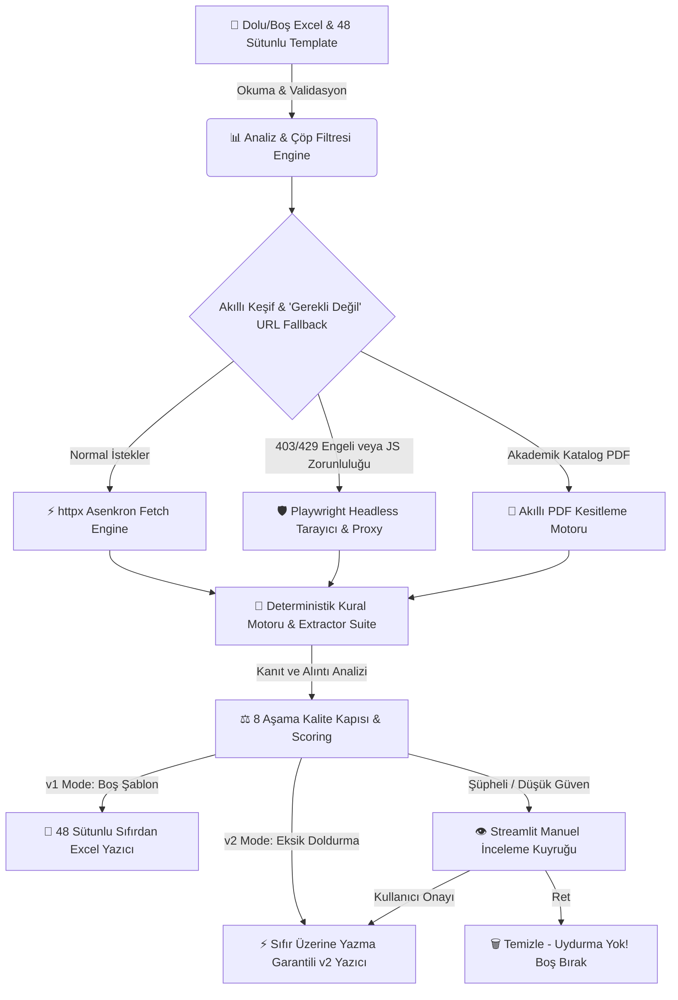

# 🎓 Üniversite Veri Otomasyonu & 48 Sütunlu Program Pipeline (v3.2)

> **Yüksek Hassasiyetli, API Anahtarsız, %100 Deterministik & Kanıt (Evidence) Tabanlı Üniversite Veri Toplama, Doğrulama, Eksik Sütun Doldurma (v2) ve Excel Otomasyon Sistemi.**

[](https://www.python.org/downloads/)
[](https://streamlit.io)
[](https://docs.pytest.org)
[](#)

---

## 🌟 Sistem Hakkında & Vizyon

**Üniversite Veri Otomasyonu**, yüklenen kaynak Excel dosyalarındaki üniversitelerin resmî web sitelerini, sitemap haritalarını ve akademik katalog PDF'lerini derinlemesine tarayarak, eksik kabul kuralları, program detayları, yabancı dil yeterlilikleri, eğitim ücretleri ve sürelerini otomatik olarak tespit eder.

Sistem **%100 deterministik kural ve RegEx motorlarıyla**, açık **kanıt (quote) cümlesi barındıran** verileri derler. Toplanan tüm bilgiler 8 aşamalı sert kalite kapısından (Hard QA Gate) geçtikten sonra, orijinal Excel dosyasının hücresel stiline ve renklerine zerre kadar zarar vermeden **48 sütunlu** hassas çıktı biçiminde üretime aktarılır.

---

## 🔥 Ana Özellikler & Öne Çıkan Mühendislik Yenilikleri

### 1. ⚡ Program Verilerini Doldurma v2 (Dolu Excel Eksik Sütun Doldurucu)
- **🛡️ Sıfır Üzerine Yazma Garantisi (Zero Overwrite Policy):** Zaten dolu olan Excel dosyalarında (`united_states_of_america_california_university_country_review_skill_kontrollu.xlsx` vb.) var olan hiçbir hücreye, veriye veya biçime dokunulmaz. Sadece boş (`None`, `""`, `"—"`, `"[BOŞ]"`) kalan sütun ve hücreler doldurulur.
- **🔍 "Gerekli Değil" ve Eksik URL Otomatik Keşfi:** Hücrelerde `gerekli değil (program verisi mevcut)` veya `gerekli değil` yazıyorsa veya URL bilgisi eksikse atlama yapılmaz. Sistem, üniversitenin resmî domaini üzerinden hedefli web aramaları (`targeted_search.py`) yaparak eksik Kabul, Dil, Ücret veya Program sayfalarını otomatik bulur ve tarar.
- **🔗 Akıllı URL Kaynak Birleştirme:** Dolu Excel'deki `Kabul Verisi Kaynağı` hücresinde yer alan etiketli URL'ler (`Program:`, `Kabul:`, `Dil:`, `Ücret:`) ayrıştırılır. İsteğe bağlı yüklenen v1 tarzı URL Kaynak Excel'indeki verilerle çakışmasız harmanlanır.
- **📝 Referans Yazım ve Biçimlendirme:** Referans dosyaya tam uyumlu olarak Minimum GPA Türkçe ondalıklı virgülle (`"2,25"`, `"2,5"`), eğitim süresi birimleriyle (`"60 units"`, `"4 yıl / 124 credits"`), ücretler dönemsel birimleriyle (`"1.857 USD/unit (uluslararası graduate, 2025–2026)"`), mantıksal alanlar Türkçe bayraklarla (`"Evet"`, `"Hayır"`, `"Koşullu"`) doldurulur. Yeni doldurulan her hücreye kaynak URL açıklaması (Comment) eklenir.

### 2. 🛡️ 8 Aşama Sert Kalite Kuralı Motoru & Otomatik QA
Üretilen ve çıkarılan her satır Excel hücresine basılmadan önce **8 amansız denetim kuralından** geçer:
1. **Yüksek Doluluk (Completeness Check):** Eğitim süresi, kabul GPA, yıllık ücret gibi kritik sütunların eksiksiz dolulup dolmadığı matematiksel olarak ölçülür.
2. **Yalnızca Gerçek + Doğrulanmış Programlar:** Akıllı taksonomi ve içerik süzgeci sayesinde genel program listeleri, blog haberleri, kayıt portalı sayfaları, duyurular ve JSON-LD şemaları program sayılmaz; sert bir şekilde reddedilir.
3. **Resmî Kaynak Güvencesi (Domain Trust):** Yalnızca üniversiteye ait tescilli kurumsal domain ağacı taranır, üçüncü parti güvensiz platformlar sisteme dahil edilmez.
4. **Kapsama Uygun Politika Birleştirme (Scope Priority):** Lisans ile Yüksek Lisans sayfaları ayrıştırılır; genel üniversite politikaları program özel verilerle hiyerarşik olarak harmanlanır.
5. **Kanıt Kesitleri (Evidence Annotation):** Çıkarılan her alan için dayanak oluşturan kaynak alıntı cümlesi ve kaynak URL, doğrudan ilgili Excel hücresinin açıklamasına/yorumuna nakledilir.
6. **Tekilleştirme & Çöp Filtresi:** Boşluk, noktalama ve büyük-küçük harf duyarsız anahtarlama sayesinde aynı programın farklı başlık varyasyonları çift kayıt yapmaz, çöp veriler temizlenir.
7. **Uydurma Sıfır — "Kanıt Yoksa Boş Bırak":** Destekleyici açık web kanıtı bulunmayan hücrelere asla sabit, rastgele veya tahminî bir veri yazılmaz; hücre tertemiz boş bırakılır.
8. **Görsel QA Özet Paneli:** İşlem bitiminde Streamlit ekranı üzerinde doluluk barları, renk kodlu kartlaşmış kural raporları ve canlı başarı grafiği açılır.

### 3. 🌐 Windows App Control Uyumlu Saf HTML Tablo Mimarisi
Windows Uygulama Denetimi İlkesi (App Control Policy) olan kurumsal sistemlerde Streamlit'in varsayılan `st.dataframe()` bileşeni C-extension (`pandas` / `pyarrow` `.pyd` DLL) engel takılmasına sebep olur. Sistem, yerel saf Python ve HTML tablo işleyicisi (`_render_table`) ile güçlendirilmiştir; hiçbir harici DLL yüklemesi gerektirmeden %100 kararlı çalışır.

### 4. 🧮 Genişletilmiş ve Deterministik Veri Çıkarıcı Suite
Sistem, dil bilimsel bağlam analizi yapan uzmanlaştırılmış harbi çıkarıcı modülleri kucaklar:
- ⏳ **Eğitim Süresi (3 Tier Extractor):** Derece ve yıl birlikteliği (0.93 güven), sayfa içi anısal bağlam (0.88 güven) ve toplam kredi saatinden matematiksel tahmin (0.78 güven) katmanları.
- 🎓 **Minimum Kabul GPA (Row-based Isolation):** Sürdürme ve mezuniyet GPA eşiklerini atlayan, sadece kabul şartına yönelen satır bazlı izolasyon algoritmaları.
- 🗣️ **Dil Yeterlilik (IELTS, TOEFL, Duolingo):** Program özel minimum test eşiklerini ve koşul kural setlerini kusursuz çeken motor.
- 💰 **Harç ve Başvuru Ücretleri:** Yıllık eğitim ücretleri ile tek seferlik başvuru maliyetlerini ayıklayan semantik okuyucular (`tuition.py`, `application_fee.py`).
- 💼 **Kariyer Çıktıları & Başvuru Belgeleri:** Standard test zorunluluğu (SAT/GRE), staj (internship) imkanları ve aranan resmi belge takımı çıkarıcıları.

### 5. 🕷️ Çok Katmanlı Güvenli Tarama & Çöl Geçirmez Tarayıcı Mimarisi
- **Hızlı Katman (httpx Asenkron):** Saniyelik asenkron eşzamanlı HTTP istekleriyle sitemizi bloklama yapmayan siteler anında parse edilir.
- **Direnme Katmanı (Playwright & Impersonation):** Cloudflare, 403 Forbidden, 429 Too Many Requests engeline takılan ya da mecburi JavaScript talep eden hedeflerde akıllıca **Headless Chromium / Edge Tarayıcı (Playwright)** ile Proxy desteği tetiklenir.
- **PDF Katalog Cımbızlama:** Resmî akademik katalog PDF'leri okunduğunda dosyanın tümü değil, yalnızca aranan spesifik program başlığının çevresindeki **bağlam sekmeleri** (content sections) izole edilir.

### 6. 💾 Checkpoint & Kesinti Koruması
Tarama uzun mu sürüyor? Elektrik veya bağlantı mı kesindi? Akıllı checkpoint mekanizması (`checkpoint.py`), tamamlanan her safhayı anlık güvence altına alarak sonraki başlangıçta kalınan yerden kaldırımsız devam edilmesini ve eklenen tek bir satırın dahi bozulmamasını garanti eder.

---

## ⚙️ Sistem Mimarisi & Karar Akış Şeması



---

## 📂 Detaylı Proje ve Modül Yapısı

```
veri-otomasyonu/
├── app.py                      # Streamlit Ana Web Uygulaması (4 Çalışma Modu & Saf HTML Tablo Panel)
├── requirements.txt            # Python kütüphane bağımlılık listesi
├── run_dc_e2e_test.py          # Uçtan uca (E2E) saha doğrulama betiği
├── QUALITY_UPGRADE.md          # Kalite iyileştirme dokümanı
├── BOT_ACIKLAMA.md             # Bot çalışma felsefesi detayları
├── .env.example                # Ortam yapılandırmaları ve proxy konfigürasyon şablonu
├── .gitignore                  # Git dışlama kuralları (venv, cache, data IO klasörleri)
│
├── src/                        # 🧠 Sistem Çekirdeği ve Modüler Mimarisi
│   ├── config.py               # Pydantic tabanlı dinamik konfigürasyon yönetimi
│   ├── models.py               # Pydantic veri modelleri (Adaylar, Skorlar, Durum Kararları)
│   ├── domain_utils.py         # Resmî site doğrulama, ağaç ile url parse kontrolleri
│   ├── excel_reader.py         # Stil korumalı Excel okuma motoru
│   ├── excel_writer.py         # Format ve renk kaybettirilmeyen 48 Sütunlu v1 çıktı yazıcısı
│   ├── manual_review.py        # Streamlit arayüzlü İnsan Onayı (HITL) servis mantığı
│   ├── pipeline.py             # Ana orkestrasyon ve eşzamanlı araştırma koordinesi
│   │
│   ├── audit/                  # 🔍 Denetim ve Kütük Sistemi
│   │   ├── evidence_store.py   # Çıkarılan hücreler için alıntı (quote) ve kaynak URL arşivi
│   │   └── review_queue.py     # İnsan onayına gidecek düşük skorlu bulguların bekçi kuyruğu
│   │
│   ├── extractors/             # 🧮 Deterministik ve Bağlamsal Veri Çıkarıcılar
│   │   ├── duration.py         # 3 Katmanlı eğitim süresi tahmincisi
│   │   ├── gpa.py              # Satır bazlı minimum kabul GPA çıkarıcısı
│   │   ├── language_tests.py   # IELTS, TOEFL, Duolingo puan kuralları
│   │   ├── tuition.py          # Yıllık harç ve ödeme kuralları çıkarıcı
│   │   ├── application_fee.py  # Tek seferlik başvuru maliyet kesitleri
│   │   ├── application_documents.py # Başvuru belge listeleri
│   │   ├── boolean_fields.py   # Transkript, mülakat, İngilizce ve standart test bayrakları
│   │   ├── career_outcomes.py  # Mezuniyet sonrası kariyer olanakları bilgisi
│   │   ├── deadlines.py        # Son başvuru ve kabul günleri motoru
│   │   ├── internship.py       # Staj imkanları ve kariyer pratikleri aratıcı
│   │   └── semantic_fields.py  # Anlatı, metinsel paragraf ve politika birimi çıkarımı
│   │
│   ├── fetch/                  # 🕷️ Ağ Çekme ve Pars Etme Katmanı
│   │   ├── page_fetcher.py     # Asenkron httpx + Playwright browser Fallback yöneticisi
│   │   ├── html_extractor.py   # Paragraf, tablo ve HTML liste bütünlüğünü koruyan ayrıştırıcı
│   │   └── pdf_extractor.py    # Kataloglar için saf ve eksiksiz metin çekiştirme motoru
│   │
│   ├── program_pipeline/       # 🚀 48 Sütunlu Şablon ve v1/v2 Akış Motoru
│   │   ├── pipeline.py         # v1 Paralel ve checkpoint güvenceli tam akış denetleyicisi
│   │   ├── pipeline_v2.py      # v2 Eksik sütun doldurma ve hedefli URL keşif denetleyicisi
│   │   ├── excel_writer_v2.py  # v2 Sıfır üzerine yazma garantili ve referans biçimli Excel yazıcısı
│   │   ├── program_discovery.py# Sitemap ve sayfa başlıklarından gerçek program tespiti
│   │   ├── targeted_search.py  # Eksik alanlar için resmî domain içi ikincil arama motoru
│   │   ├── program_extractor.py# Sayfa içi kural tabanlı kapsamlı derin alan veri dolgusu
│   │   ├── program_manifest.py # Bulunan programların liste şemaları
│   │   ├── program_quality.py  # 8 Sert Kural, Kalite Kapısı ve Çöp Program Süzgeci
│   │   ├── qa_exporter.py      # Görsel QA Raporu üreticisi ve sert baraj kesicisi
│   │   ├── evidence_validator.py # Kanıt (quote) cümle doğrulayıcı ve kontrolcüsü
│   │   ├── field_merger.py     # Lisans/Y.Lisans politikaları & program verilerini birleştirici
│   │   ├── checkpoint.py       # Yarım kalan akışları kesinti noktasından başlatan motor
│   │   ├── normalizer.py       # Çift kaydı kıran akıllı anahtar (space/punctuation insensitive)
│   │   ├── source_excel_reader.py # Esnek "Gerekli Değil" URL sıçramalarını yakalayan okuyucu
│   │   └── template_reader.py  # Şablon ve Dolu Excel tablosu mimari ayrıştırıcı
│   │
│   └── search/                 # 🔎 Arama ve Keşif Aracı Modülleri
│       ├── site_discovery.py   # Resmî kök site & sitemap içi navigasyonel gezgin
│       ├── web_searcher.py     # DuckDuckGo, Bing, Google paralel arama motoru takviyeleri
│       └── query_builder.py    # Akıllı, hedefi tam vuran sorgu kalıpları üreteci
│
├── tests/                      # 🧪 220+ Kapsamlı Otomatik Test ve v2 Birim Doğrulamaları
│   ├── test_pipeline_v2.py     # v2 Pipeline, sıfır ezme ve biçim doğrulama testleri
│   └── ...
└── data/                       # 💾 Lokal Dosya ve Önbellek Veritabanı
    ├── input/                  # Girdi Kaynak, Şablon ve Dolu Excel dosyaları
    ├── output/                 # 48 Sütunlu çıktı tabloları ve QA logları
    └── cache/                  # Web indirme önbelleği ve tarayıcı ön kütükleri
```

---

## 🛠️ Kurulum ve Sıfırdan Başlangıç

Sistemi lokal makinede **Windows PowerShell** ya da terminal üzerinde kurup anında çalıştırmak için adım adım talimatlar:

### 1. Projeyi Bilgisayarınıza İndirin / Klonlayın
```powershell
git clone <depo-baglantisi>
cd veri-otomasyonu
```

### 2. Sanal Ortam (Virtual Environment) Oluşturun
```powershell
python -m venv .venv
.\.venv\Scripts\activate
```
*(macOS / Linux kullanıcıları için activation komutu: `source .venv/bin/activate`)*

### 3. Paketleri ve Tarayıcı Motorunu Yükleyin
```powershell
pip install --upgrade pip
pip install -r requirements.txt
playwright install chromium
```

---

## 🧪 Test Paketi ve Saha Doğrulama

Kod üzerinde değişiklik yaptığınızda mimarinin bütünselliğinden emin olmak için depoda var olan **220'den fazla pytest entegre birim test serisini** saniyeler içinde çalıştırabilirsiniz:

```powershell
python -m pytest tests/ -v
```

---

## 🚀 Web Arayüzü Kullanım Rehberi (Streamlit UI)

1. Uygulama arayüzünü konsoldan çağırarak tarayıcıda tetikleyin:
   ```powershell
   .\.venv\Scripts\python.exe -m streamlit run app.py
   ```

2. Tarayıcınızda açılan **Streamlit Panelinde** soldaki menüden arzuladığınız çalışma modunu seçin:
   - **🔍 URL Bulma:** Yalnızca web sitesi veya temel başvuru URL'si eksik olan yerleri otomatik buldurup doldurmak için.
   - **📋 Program Verilerini Doldurma (v1 — Boş Şablon):** Boş bir 48 sütunlu şablona web'den bulunan tüm programları sıfırdan doldurmak için.
   - **⚡ Program Verilerini Doldurma (v2 — Dolu Excel Eksik Sütunlar) [ÖNERİLEN]:** Halihazırda dolu olan Excel dosyanızdaki mevcut verilere zerre dokunmadan, yalnızca boş/eksik kalan sütunları referans biçiminde doldurmak için.
   - **🔍+📋 URL Bul + Program Doldur:** Her iki işlemi ardışık çalıştırmak için.

3. **v2 Modu Kullanımı:**
   - **1️⃣ Dolu Program Excel'i (Zorunlu):** Eksik sütunları tamamlanacak dolu `.xlsx` dosyanızı yükleyin.
   - **2️⃣ URL Kaynak Excel'i (Opsiyonel):** Harici URL kaynak dosyanız varsa yükleyin (yoksa dolu Excel'in kendi `Kabul Verisi Kaynağı` sütunundaki bağlantılar veya otomatik URL keşfi kullanılır).

4. **"🚀 v2 Eksik Sütunları Doldurma İşlemini Başlat"** butonuna basın.

5. İşlem tamamlandığında **Görsel QA Paneli**'ni ve doluluk oranlarını inceleyip **⬇️ v2 Doldurulmuş Excel'i İndir** butonuyla eksikleri tamamlanmış Excel dosyanızı indirin!

---
*Geliştirilmiş deterministik mimari ile her zaman en doğru, uydurmasız, esnek ve kanıtlı otomasyon!* 🚀🎓

---

## 🛠️ Kullanılan Teknolojiler ve Kütüphaneler (Bot Açıklaması)

| Kategori | Kütüphane / Araç | Kullanım Amacı |
| :--- | :--- | :--- |
| **Arayüz (UI)** | `streamlit` | Web arayüzü, dosya yükleme ve onay paneli (`app.py`) |
| **Excel Veri Yönetimi** | `openpyxl` | Hücre stilleri ve biçimlendirmeleri koruyarak Excel okuma/yazma |
| **Veri Şablonları & Tip Güvenliği** | `pydantic`, `pydantic-settings` | Veri yapıları, doğrulama ve konfigürasyon yönetimi |
| **Ağ ve HTTP İstemcisi** | `httpx` | Asenkron, hızlı web istekleri |
| **Scraping & Tarayıcı Otomasyonu** | `playwright` | Bot korumalı veya JS yüklü siteleri açmak için headless tarayıcı |
| **Metin & Doküman Analizi** | `beautifulsoup4`, `lxml`, `pypdf` | HTML ve PDF içeriklerinden temiz metin çıkarma |
| **Hata & Retry Yönetimi** | `tenacity` | Başarısız isteklerde otomatik yeniden deneme mekanizması |

---

## 🔄 Sürüm Notları & Kalite Güncellemeleri (v3.2)

Bu sürüm, iki Excel dosyasından `Programlar` sheetini dolduran akışın yüksek-hassasiyetli sürümüdür.

**Düzeltilen Ana Problemler:**
- HTML paragraf ve listelerinin çıkarım sırasında kaybolması giderildi.
- Resmî domaindeki her sayfanın program sayılması engellendi.
- `JSON-LD Structured Data`, program listeleri, blog, kayıt, başvuru ve genel politika sayfaları program satırı olarak reddediliyor.
- Program adı; H1, sayfa başlığı, URL ve sayfa içeriği birlikte doğrulanarak seçiliyor.
- Aynı programın yinelenen URL/başlık varyasyonları tekilleştiriliyor.
- Resmî akademik katalog PDF'leri keşfediliyor; yalnızca tam program adının çevresindeki bölüm program-özel veri için kullanılıyor.
- Genel kabul/dil/ücret bilgileri program-özel bilgilerle kanıt ve kapsam önceliğine göre birleştiriliyor.
- Başvuru türü, belgeler, zorunlu maddeler, koşullu mülakat, İngilizce yeterlilik, standart test politikası, transkript şartı, akademik yıl ve kariyer çıktıları için deterministik çıkarıcılar eklendi.
- Program kaynağı `Program Adı` hücresinin yorumuna yazılıyor; program URL'si artık yanlışlıkla `Kabul Verisi Kaynağı` sütununa konulmuyor.
- Checkpoint yüzünden yeni çıktıda üniversitelerin kaybolması engellendi.
- PDF ham içeriği korunuyor ve gerçekten PDF ayrıştırıcısına iletiliyor.
- `PROXY_URL`, HTTP + curl + Playwright katmanlarının tümünde kullanılıyor.
- Gemini/API anahtarı gereksinimi ve eski ayarları kaldırıldı.

---

## 🏙️ Şehir & Yaşam Rehberi Pipeline Kuralları

Bu bölüm, **Şehir & Yaşam Rehberi (`city_livability_pipeline`)** otomasyon botunun uymak zorunda olduğu tüm veri toplama, doğrulama, kalite kapıları, matematiksel formüller ve Excel yazım kurallarını detaylandırmaktadır.

### 1. Temel Felsefe ve Çalışma İlkeleri
- **%100 Deterministik & Sıfır Uydurma:** Bot asla tahminî veya uydurma veri üretemez. Doğrulanabilir açık web kanıtı bulunamayan hücreler kesinlikle boş bırakılır.
- **Kanıt ve Kaynak URL Zorunluluğu:** Fiyat, 1-5 skala puanı, boolean bayrak veya sayısal veriler için kaynak URL ve kanıt metni bulunması zorunludur.
- **Format & Yorum Güvencesi:** Doldurulan her hücrenin Excel açıklamasına (Comment) Kaynak URL, Kanıt Alıntısı ve Doğrulama kuralı işlenir.
- **Bağımlılık Zinciri:** Üniversiteler -> Şehirler -> İlçeler -> Kampüsler sırasıyla işlenir.

### 2. 8 Katı Kalite Kapısı (Hard Quality Gates)
1. **Domain Otoritesi:** `.gov.tr`, `tuik` (1.0), `.edu.tr` (0.95), genel web (0.50).
2. **Aralık & Tip Güvenliği:** Mantıklı fiziksel/ekonomik sınırlarına tam uyum şarttır.
3. **Kanıt Alıntısı (Quote Containment):** Çıkarılan değerin kaynak metin içinde birebir veya sayısal varyantlarıyla geçmesi zorunludur.
4. **Güncellik & Para Birimi:** 2 yıldan eski verilerin güven puanı kırılır.
5. **Coğrafi & İlişkisel Bütünlük:** Koordinatların Türkiye sınırlarında olması; sahte koordinatların elenmesi.
6. **Uydurma Sıfır:** Boş/geçersiz veriler için hücre boş bırakılır.
7. **3 Kademeli Güven Puanı:** Yüksek (>=0.85), Orta (0.60-0.84), Düşük (<0.60, Manuel inceleme).
8. **Hücre Yorumu & Meta Veri:** Hücrelere zengin kanıt yorumu eklenir.

### 3. Matematiksel & Türetilmiş Formül Kuralları
- **Aylık Toplam (Yurtta):** KYK Yurt Ücreti + Aylık Yeme-İçme + Öğrenci Abonmanı + 2.500 TL (Kişisel Gider)
- **Aylık Toplam (Ev Arkadaşlı):** Oda Başı Kira + ((Kış Faturası + Yaz Faturası)/2 + Aidat + İnternet)/2 + Yeme-İçme + Abonman + 2.500 TL
- **Aylık Toplam (Tek Yaşam):** 1+1 Kira + ((Kış Faturası + Yaz Faturası)/2) + Aidat + İnternet + Yeme-İçme + Abonman + 2.500 TL
- **Yıllık Toplam:** Aylık Toplam * 9
- **TR Ortalamasına Göre Maliyet Endeksi:** (Şehir Ev Arkadaşlı Maliyeti / TR Medyan Maliyeti) * 100
- **Öğrenci Yaşanabilirlik Skoru (0-100):** Maliyet (%35), Sosyal Hayat (%20), Güvenlik (%15), Ulaşım (%15), Staj (%15)
- **Öğrenci / Nüfus Oranı (%):** (Yükseköğretim Öğrenci Sayısı / Nüfus) * 100
